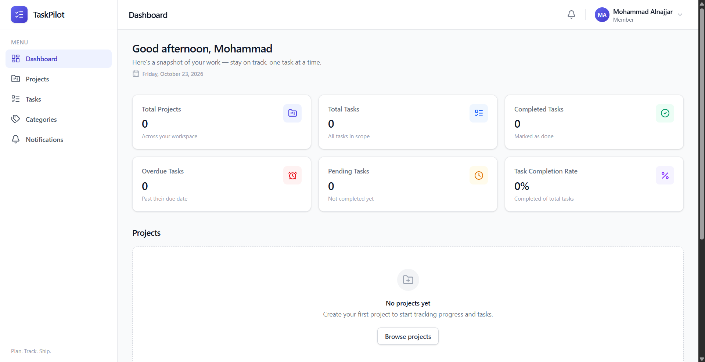
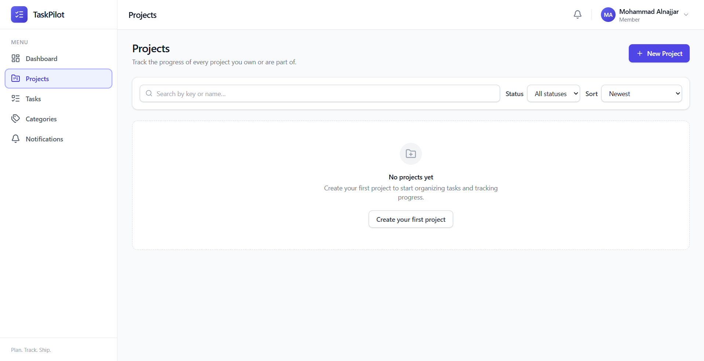
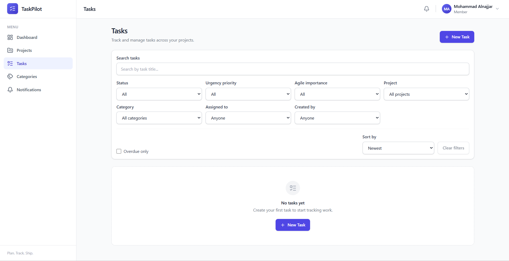
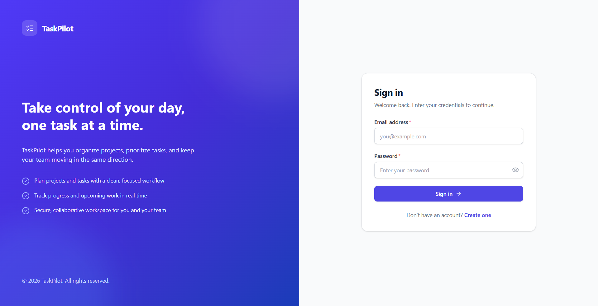
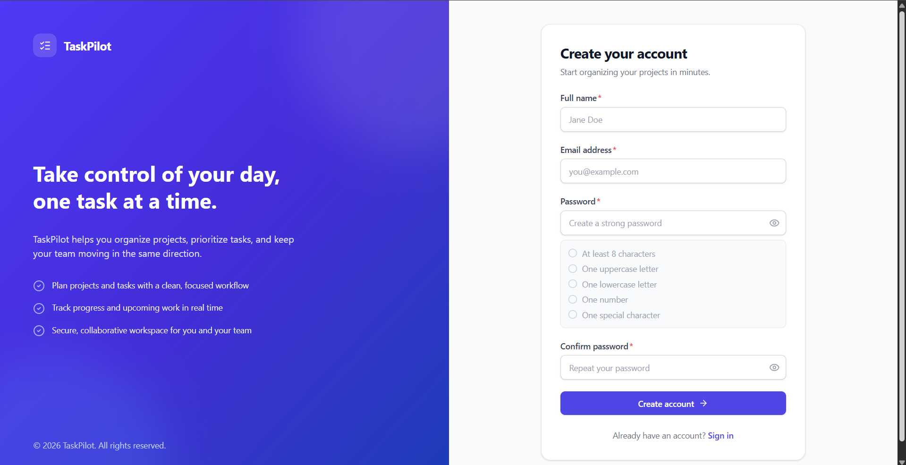

# TaskPilot

<p align="center">
  <strong>TaskPilot — Task & Project Management Platform</strong>
</p>

<p align="center">
  A full-stack application for organizing projects, collaborating with team members, tracking tasks, and monitoring progress.
</p>

**TaskPilot** is a full-stack **Task & Project Management System** built with **React, Node.js, Express.js, and PostgreSQL**. It combines project organization, task tracking, project memberships, notifications, and team collaboration in a single application. The backend exposes documented REST APIs, while the frontend provides dashboards and dedicated management screens.

## Screenshots

> Add your own screenshots to `docs/screenshots/` before publishing this section. The paths below are examples and will not display until the image files exist.

### Dashboard

<!--  -->

### Projects

<!--  -->

### Project Details & Members

<!--  -->

### Tasks

<!--  -->

### Authentication

<!--
<table>
  <tr>
    <td width="50%"><strong>Sign In</strong><br></td>
    <td width="50%"><strong>Register</strong><br></td>
  </tr>
</table>
-->

## Key Features

### Authentication & Account Access
- User registration and login
- JWT-based authentication
- Protected frontend routes and backend endpoints
- Password hashing with bcrypt

### Project Management
- Create, view, edit, and manage projects
- Project overview and status information
- Manage project members and their roles

### Task Management
- Create, view, and edit tasks associated with projects
- Track task progress through **To Do → In Progress → Done**
- Organize tasks using categories and priorities
- Task comments and attachments

### Dashboard & Notifications
- Dashboard statistics and project progress views
- Upcoming-task components
- Notification screens and filters
- Activity logging on the backend

### API & Developer Experience
- Modular REST API architecture
- Swagger / OpenAPI documentation configuration
- Request validation, centralized error handling, and asynchronous handlers
- Backend automated test files covering major feature areas

## Technology Stack

| Layer | Technologies |
| --- | --- |
| **Frontend** | React, JavaScript (JSX), Vite |
| **Backend** | Node.js, Express.js |
| **Database** | PostgreSQL |
| **Authentication** | JWT, bcrypt |
| **API Documentation** | Swagger / OpenAPI |
| **Security & Middleware** | Helmet, CORS, request validation |
| **Testing** | Automated backend tests |
| **Version Control** | Git, GitHub |

## Project Structure

```text
TaskPilot/
├── backend/
│   ├── src/
│   │   ├── bootstrap/       # Default admin setup
│   │   ├── config/          # Database, environment, Swagger
│   │   ├── controllers/     # Request handlers
│   │   ├── docs/            # API documentation definitions
│   │   ├── middleware/      # Authentication, validation, errors, uploads
│   │   ├── repositories/    # Database access
│   │   ├── routes/          # API routes
│   │   ├── services/        # Business logic
│   │   ├── utils/           # Shared helpers
│   │   ├── validators/      # Request validators
│   │   ├── app.js
│   │   └── server.js
│   ├── tests/               # Automated API/backend tests
│   ├── uploads/             # Runtime uploads (ignored by Git)
│   ├── .env.example
│   ├── package.json
│   └── README.md
├── frontend/
│   ├── public/
│   ├── src/
│   │   ├── api/             # HTTP client and endpoints
│   │   ├── components/      # Reusable UI components
│   │   ├── contexts/        # Authentication context
│   │   ├── hooks/
│   │   ├── layouts/
│   │   ├── pages/           # Auth, dashboard, projects, tasks, etc.
│   │   ├── routes/          # Route definitions and guards
│   │   ├── services/        # Frontend API services
│   │   ├── utils/
│   │   ├── App.jsx
│   │   └── main.jsx
│   ├── .env.example
│   ├── package.json
│   └── vite.config.js
├── .gitignore
├── package.json
└── README.md
```

## Main Modules

| Module | Purpose |
| --- | --- |
| **Auth** | Account registration, login, and authenticated access |
| **Projects** | Project creation, updates, and overview |
| **Project Members** | Membership and role management |
| **Tasks** | Task creation, assignment/workflow-related features, and progress tracking |
| **Categories** | Task organization |
| **Comments & Attachments** | Task discussion and file handling |
| **Dashboard** | Summary and progress information |
| **Notifications** | In-app notification-related features |
| **Activity Logs** | Backend tracking of activities |

## Task Workflow

```text
To Do  ──────>  In Progress  ──────>  Done
```

## Backend Architecture

The backend organizes responsibilities into layers:

1. **Routes** define the available API endpoints.
2. **Middleware** handles authentication, validation, and errors.
3. **Controllers** receive requests and return responses.
4. **Services** implement business logic.
5. **Repositories** handle database operations.
6. **Validators** define request validation rules.

This structure helps keep API logic maintainable and easier to test.

## Database

TaskPilot uses **PostgreSQL** as its relational database. The project's data model includes entities for users, projects, project members, categories, tasks, and activity logs. Other feature modules include task comments, attachments, and notifications.

> The exact database schema, migration/import commands, and constraints should be verified from the actual database setup before they are documented here.

## Authentication & Security

- JWT-based authentication and protected API access
- bcrypt password hashing
- Request-validation middleware
- Centralized error handling
- Helmet and CORS middleware
- Local environment files excluded from Git

> Before a public release, verify authorization rules, file-upload safeguards, and production configuration against the current implementation.

## Installation & Local Development

### Prerequisites

- Node.js and npm
- PostgreSQL
- Git

### 1. Clone the project

```bash
git clone https://github.com/mohammadalnajjar04/TaskPilot.git
cd TaskPilot
```

### 2. Install backend dependencies

```bash
cd backend
npm install
```

### 3. Configure backend environment

Copy the example environment file to a local `.env` file:

**Windows PowerShell:**

```powershell
Copy-Item .env.example .env
```

**macOS / Linux:**

```bash
cp .env.example .env
```

Edit the new `.env` to match your local PostgreSQL configuration and other required settings. **Never commit real credentials or tokens.**

### 4. Set up the database

Create and configure the PostgreSQL database according to your project's schema/setup. Database initialization files were not present in the supplied file list, so an exact import command is intentionally not provided.

### 5. Run the backend

Check the available scripts in `backend/package.json`, then use the script configured for development or startup. For example, if the script is named `dev`:

```bash
npm run dev
```

### 6. Install and configure the frontend

Open a second terminal in the project root:

```bash
cd frontend
npm install
```

Create a local environment file if required:

**Windows PowerShell:**

```powershell
Copy-Item .env.example .env
```

Check the example file for the API base URL and configure it to match your local backend.

### 7. Run the frontend

```bash
npm run dev
```

Open the local address printed by Vite in the terminal.

## API Documentation

The backend includes Swagger configuration and route documentation source files under:

- `backend/src/config/swagger.js`
- `backend/src/docs/`

> Add the exact Swagger UI route after confirming it in the code.

## Testing

The repository includes backend test files for:

- Authentication
- Projects and project members
- Tasks, comments, and attachments
- Categories
- Dashboard
- Notifications

To run the tests, check the scripts in `backend/package.json` and use the configured test command (commonly `npm test`).

> Include a verified test count and passing-test screenshot only after running the current test suite. The file list confirms **nine test files**, but does not establish the present pass count.

## Git & Environment Safety

The repository should include a root `.gitignore` that excludes at least:

```gitignore
node_modules/
.env
.env.*
!.env.example
dist/
build/
coverage/
*.log
backend/uploads/*
!backend/uploads/.gitkeep
```

Check that `.env.example` contains **placeholders only**, not real passwords, database credentials, or API keys.

## Future Improvements

- Expand regression and integration test coverage
- Add end-to-end UI tests
- Add a documented deployment process
- Add screenshots and a short demo video
- Publish an ERD and database setup guide

## Author

**Mohammad Al-Najjar**

- [GitHub](https://github.com/mohammadalnajjar04)
- [LinkedIn](https://www.linkedin.com/in/mohammad-alnajjar04)

## Notes

This README describes the project based on its shared source-file structure and previously discussed features. Verify environment-variable names, database setup, scripts, and exact API/authorization behavior against the code before announcing that installation and every feature are fully production-ready.
